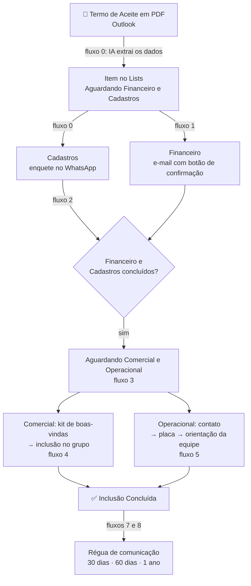

# Customer Onboarding Automation — Inclusão de clientes com Outlook, IA, Microsoft Lists e WhatsApp

Automação em [n8n](https://n8n.io), dividida em 11 fluxos, que conduz a **inclusão de um novo cliente** num bolsão de segurança do começo ao fim. Ela lê o **Termo de Aceite** (PDF da resposta do formulário) que chega por e-mail, extrai os dados do cliente com **IA**, registra tudo no **Microsoft Lists (SharePoint)** e coordena as áreas envolvidas: **Financeiro** por e-mail, **Cadastros**, **Comercial** e **Operacional** por enquetes no WhatsApp. No fim, acompanha o cliente por uma **régua de comunicação** de 30 dias, 60 dias e 1 ano.


## O problema

Cada novo morador que aderia a um bolsão de segurança passava por quatro áreas: o Financeiro fazia o cadastro de cobrança, Cadastros registrava o cliente nos sistemas de monitoramento, o Comercial mandava o kit de boas-vindas e incluía o cliente no grupo do bolsão, e o Operacional fazia contato, instalava a placa e orientava a equipe. Tudo era combinado por e-mail e mensagem, sem registro central. Os dados do cliente eram redigitados de um PDF em vários lugares, e era difícil saber em que etapa cada inclusão estava.

## Como funciona

A lista **Adesão de Clientes** no Microsoft Lists é a fonte da verdade: cada cliente é um item, com uma coluna de status por área (`FinanceiroStatus`, `CadastrosStatus`, `ComercialStatus`, `OperacionalStatus`) e uma geral (`StatusAutomacao`). As áreas respondem pelo WhatsApp, pelo e-mail ou direto no Lists.



### Os fluxos

| # | Fluxo | Gatilho | O que faz |
|---|-------|---------|-----------|
| 0 | Recebimento de Contrato Assinado (Termo de Aceite) | Outlook (e-mail com anexo) | Aceita só remetentes autorizados. Lê cada PDF, um por vez, valida que é um Termo de Aceite, identifica o bolsão pelo nome do formulário, extrai os dados do cliente com IA (saída em JSON Schema), evita duplicados (CPF/CNPJ + bolsão), cria o item no Lists, aciona o Financeiro e envia a enquete de Cadastros. |
| 1 | Financeiro por E-mail | Webhook | Envia ao Financeiro um e-mail HTML com os dados do cliente e um botão *Confirmar cadastro realizado*. Reenvia a cada 3 dias até a confirmação, segurando os reenvios no fim de semana. |
| 2 | Receber Resposta Cadastros | Webhook (voto na enquete) | Registra a resposta de Cadastros e, se o Financeiro também concluiu, libera Comercial e Operacional. |
| 3 | Iniciar Comercial e Operacional | Webhook | Envia ao responsável comercial do bolsão o PDF do kit de boas-vindas e a enquete do kit, e ao Operacional a enquete de contato com o cliente. |
| 4 | Receber Resposta Comercial | Webhook (voto na enquete) | Kit enviado → pergunta da inclusão no grupo do bolsão. Inclusão feita → agenda a régua de comunicação. |
| 5 | Receber Resposta Operacional | Webhook (voto na enquete) | Contato feito → placa instalada → equipe orientada. Quando Comercial e Operacional terminam, marca `Inclusão Concluída`. |
| 6 | Lembretes de Pendências | Segunda, 9h | Cobra Cadastros, Comercial e Operacional pelas etapas ainda abertas, com os dados do cliente. O Financeiro é cobrado pelos reenvios do fluxo 1. |
| 7 | Régua de Comunicação | Diário, 9h | Quando a data chega, pergunta ao Comercial se o contato de 30 dias, 60 dias ou 1 ano foi feito. |
| 8 | Receber Resposta da Régua | Webhook (voto na enquete) | Registra cada contato da régua e encerra o acompanhamento quando os três foram feitos. |
| 9 | Tratamento de Erros | Error Trigger | Avisa no WhatsApp qualquer falha, com o fluxo, o nó, o erro e o link da execução. |
| 10 | Sincronizar Alterações do Lists | A cada 10 s | Detecta status alterados à mão no Lists e executa a etapa correspondente pelo mesmo caminho da enquete. Desfaz e avisa alterações feitas antes da área ser liberada. |

### Exemplo de mensagem

```text
🆕 INCLUSÃO DE CLIENTE – COMERCIAL

🏘️ Bolsão: JARDIM EXEMPLO

👤 Cliente: Fulano de Tal
📍 Endereço: Rua Exemplo 123
📞 Telefone: +55 (11) 99999-9999
📧 E-mail: fulano@exemplo.com

📌 Ação necessária:
Enviar o Kit de Boas-Vindas ao cliente.
  ○ ✅ Kit de Boas-Vindas enviado
  ○ ⚠️ Pendente
```

## Decisões de projeto

- **IA só onde o texto é livre:** o PDF do formulário tem colunas desalinhadas e campos preenchidos no lugar errado, e a IA (com JSON Schema estrito) resolve bem isso. O que é determinístico fica em código: bolsão e tipo de pessoa pelo nome do arquivo, CPF/CNPJ e datas por regex, chave anti-duplicidade e validação. A IA não tem permissão para devolver valores monetários nem dados bancários, e um filtro em código remove qualquer valor que escape.
- **Um termo por vez:** vários PDFs no mesmo e-mail (ou vários e-mails no mesmo minuto) passam por um laço. Cada termo percorre o fluxo inteiro sozinho e gera a sua própria linha no Lists.
- **Microsoft Lists como fonte da verdade:** qualquer gestor acompanha, filtra e audita as inclusões sem abrir o n8n. Os dados do cliente ficam em colunas próprias (`Cliente`, `Telefone`, `Email`, `Rua`, `Numero`).
- **Responder pelo WhatsApp, pelo e-mail ou pelo Lists:** o fluxo 10 transforma uma edição manual no Lists no mesmo evento que a enquete geraria, então existe um único caminho de processamento.
- **Redis liga a enquete ao cliente e trava cliques duplos:** cada enquete enviada guarda o ID da mensagem no Redis apontando para o item do Lists. Um contador (`INCR`) garante que um clique repetido não execute a etapa duas vezes.
- **Cada bolsão tem o seu responsável:** a lista **Matriz Bolsões** diz quem é o responsável comercial de cada bolsão e guarda o PDF do kit de boas-vindas como anexo.
- **Modo teste:** os nós que escolhem destinatários têm uma chave `MODO_TESTE`. Ligada, todas as mensagens vão para um número de teste e cada uma diz para quem iria em produção.
- **Falhas de rede não param o processo:** os nós que acessam SharePoint, WhatsApp, Outlook, Redis e OpenAI tentam de novo até 5 vezes, com 5 s entre as tentativas. As travas `INCR` ficam de fora de propósito, porque repetir um `INCR` faria a trava contar duas vezes. Se a falha persistir, o fluxo 9 avisa no WhatsApp.

## Como usar

### Pré-requisitos

- n8n (self-hosted)
- [WAHA](https://waha.devlike.pro) (WhatsApp HTTP API) com uma sessão conectada e webhooks apontando para o n8n
- Redis
- Conta OpenAI
- Conta Microsoft 365 com Outlook e um site do SharePoint
- Lista **Adesão de Clientes** com as colunas `Title` (bolsão), `Cliente`, `Telefone`, `Email`, `Rua`, `Numero`, `IDContraktor` (chave do termo), `StatusAutomacao`, `TipoMovimento`, `DataAssinatura`, `CondicoesContrato`, `LocaisInstalacao`, `ServicosContratados`, `EmpresaAster`, `NumeroProposta`, `FinanceiroStatus`, `CadastrosStatus`, `ComercialStatus`, `OperacionalStatus` e as colunas de datas e status da régua
- Lista **Matriz Bolsões** com `Title` (nome do bolsão), `Responsável` (coluna de pessoa) e o PDF do kit de boas-vindas anexado em cada bolsão

### Passos

1. No n8n: **Workflows → Import from File** e importe os 11 arquivos de `workflows/`.
2. Crie as credenciais e associe-as aos nós marcados com `<<CRIAR CREDENCIAL ...>>`: Microsoft Outlook OAuth2, Microsoft SharePoint OAuth2, Redis e OpenAI.
3. Em todos os nós do SharePoint, selecione o seu **site** e a sua **lista** (os IDs foram trocados por `<<PREENCHER>>`, mas os nomes originais ficaram como referência).
4. Nos nós HTTP que chamam a API REST do SharePoint (Matriz Bolsões e kit de boas-vindas), troque `SEU-TENANT`, `SEU-SITE` e o GUID da lista.
5. Nos nós HTTP do WhatsApp, troque `http://127.0.0.1:3000` pelo endereço do seu WAHA e ajuste `session` e `chatId`.
6. Nos nós de código **Destinatários**, preencha `REPRESENTANTES` (e-mail → WhatsApp de cada responsável comercial) e `SEMPRE`. Em produção, deixe `MODO_TESTE = false`.
7. No fluxo **0**, ajuste no nó **Remetente autorizado?** os e-mails que podem enviar o Termo de Aceite e, no código, `DOMINIOS_INTERNOS`.
8. No fluxo **1**, defina no nó **Configuração** o e-mail do Financeiro e a URL do seu n8n (usada nos botões de confirmação).
9. Nos nós que acionam outros fluxos (`/webhook/inclusao-...`), troque `localhost:5678` pela URL do seu n8n, se for diferente.
10. No WAHA, configure os webhooks de voto em enquete (`poll.vote`) para os paths `inclusao-cadastros`, `inclusao-comercial`, `inclusao-operacional` e `inclusao-regua`.
11. Em *Settings → Error workflow* de cada fluxo, selecione o fluxo **9 - Tratamento de Erros**.
12. Ative os fluxos.

## Segurança

Os fluxos publicados aqui não têm credenciais, chaves, segredos, endereços internos, IDs do tenant Microsoft, IDs de grupos nem dados reais de clientes. Todos os valores sensíveis foram substituídos por marcadores (`<<PREENCHER>>`, `SEU-TENANT`, `exemplo@exemplo.com`).
